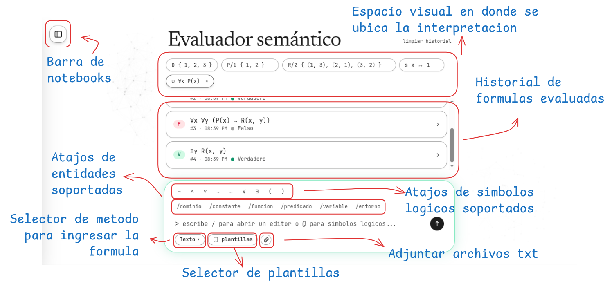
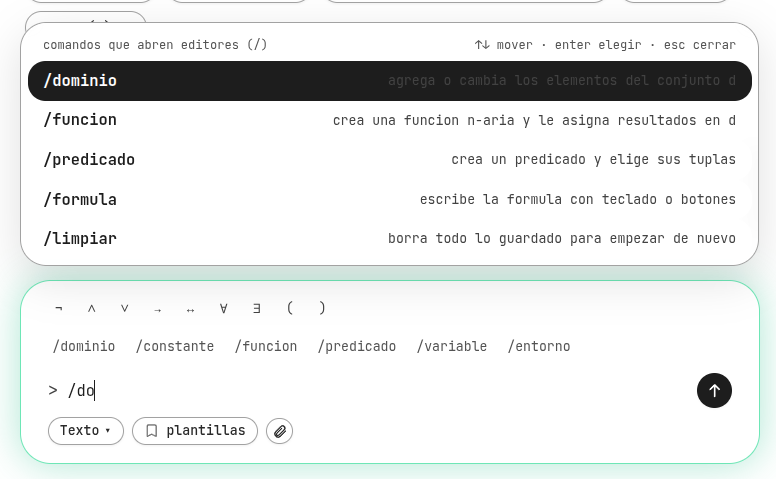
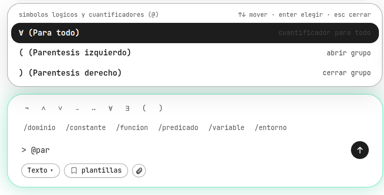
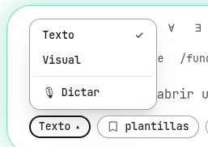
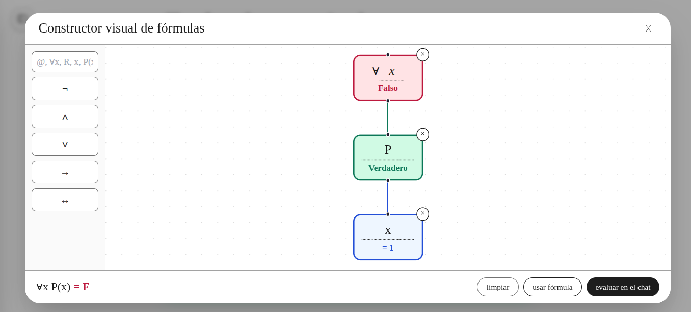
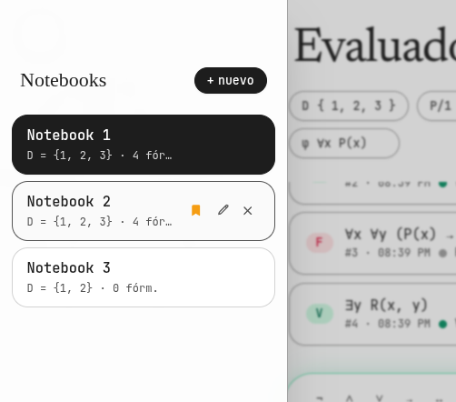
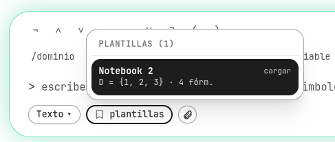

### Universidad del Valle de Guatemala
**Lógica matemática**  
**Proyecto - parcial 3**

**Integrantes:**  
Angel Chavez &bull; Sarah Estrada &bull; Tiffany Salazar

---

# Evaluador semántico

Es un proyecto web interactivo diseñado para la verificación y evaluación semántica de fórmulas en lógica de predicados de primer orden. Permite construir interpretaciones, pudiendo definir dominios arbitrarios, constantes, funciones y relaciones de cualquier aridad, así como asignar entornos de evaluación para variables libres. Soporta conectivos lógicos y cuantificadores (∀, ∃), mostrando el paso a paso.

Se pueden definir diferentes notebooks independientes que se guardan localmente, integrando un árbol sintáctico y evaluaciones semánticas que muestran testigos y contraejemplos. Además cuenta con un constructor interactivo de tuplas y fórmulas a partir de un constructor visual.

| Recurso | Enlace |
| :--- | :--- |
| **Repositorio de código** | [https://github.com/angc-labs/semantics-expert](https://github.com/angc-labs/semantics-expert) |
| **Video** | [https://youtu.be/CyhKCbj8Rw0](https://youtu.be/CyhKCbj8Rw0) |
| **Proyecto** | [https://semantics-expert-logic.vercel.app](https://semantics-expert-logic.vercel.app) |

---

## Capturas de pantalla

Las partes visuales del evaluador son las siguientes:

  

Se pueden ingresar fórmulas, dominios, predicados, etc. Las entidades se ingresan con ayuda de “/” y los símbolos se pueden consultar por medio de “@”.

  
    
  

Se permiten agregar fórmulas por medio de voz, por texto, o usando el constructor visual.

  
    
  

Se pueden agregar diferentes notebooks para evaluar diferentes interpretaciones y formular bajo esas interpretaciones. Si se marca el símbolo de bookmark, ese notebook se convierte en una plantilla que se puede usar desde el selector de plantillas.

  
    
  

